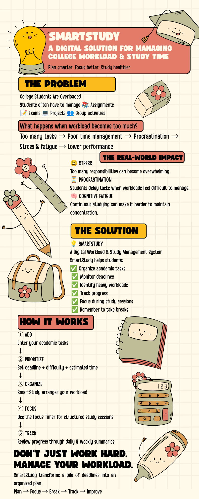

# ✦ ACTIVITY 03 ✦
### SOCIAL MEDIA INFOGRAPHICS AND MINI PROJECT DOCUMENTATION

**GE 4120 | PRELIM EXAM**

*SmartStudy: A Digital Solution for Managing College Workload & Study Time*

---

## 01 — 📌 ACTIVITY DESCRIPTION

My output is an infographic entitled **"SmartStudy: A Digital Solution for Managing College Workload & Study Time."** The main concept is to present a common problem among college students: being overloaded with assignments, exams, projects, and group activities, and introduce SmartStudy as a digital solution.

The infographic shows how excessive workloads can lead to poor time management, procrastination, stress, fatigue, and lower academic performance. It then presents SmartStudy as a solution that helps students organize tasks, monitor deadlines, prioritize workloads, focus during study sessions, and track their progress.

## 02 — 🌸 WHAT HAVE I LEARNED?

Through this activity, I learned how to communicate information effectively through visual content and infographic design. I realized that an effective infographic should not only look attractive but should also present information in a clear, organized, and understandable way.

I also learned the importance of:

- **Visual Hierarchy:** Organizing information so viewers can easily identify the most important details.
- **Color Theory:** Using colors such as cream, yellow, coral, green, and black to create contrast and establish a consistent visual theme.
- **Typography:** Combining bold, playful headings with simple and readable text.
- **Information Organization:** Presenting the problem, its impact, and the proposed solution in a logical sequence.

## 03 — 🧩 CHALLENGES & SOLUTIONS

One of the challenges I encountered was organizing the different information about college students' workload into an infographic without making the design look overcrowded. Since the topic involved several problems and proposed solutions, I needed to make sure that the information remained clear and easy to understand.

To address this, I divided the content into specific sections, including the problem, real-world impact, solution, and how SmartStudy works. I also incorporated illustrations, icons, arrows, check marks, and highlighted headings to make the information easier to follow and visually engaging.

## 04 — 🚀 FUTURE APPLICATIONS

The knowledge and skills I gained from this activity can be applied to future infographic projects, social media content, and academic presentations. I can use visual hierarchy, typography, color combinations, and information organization to communicate complex ideas more effectively.

I can also apply these skills to Civil Engineering presentations and projects, particularly when explaining technical information, presenting research findings, and communicating engineering concepts to different audiences.

## 05 — 🎨 CREATIVE PROCESS & DESIGN CHOICES

For the creative process, I first identified the problem of college students struggling to manage multiple academic responsibilities. I then organized the information into clear sections: the problem, real-world impact, solution, and how SmartStudy works.

For the design, I used a warm and playful color palette consisting of cream, yellow, coral, green, and black. The cream grid background creates a notebook or study-planner feeling, while yellow highlights important sections such as "The Problem" and "The Solution." Coral adds contrast and helps guide the reader through the infographic.

I also used bold, playful typography for the headings and simpler text styles for readability. Illustrations of pencils, notebooks, calculators, rulers, flowers, and graduation-related elements reinforce the student and academic theme.

Overall, I aimed to create an infographic that is informative, visually engaging, organized, and easy for college students to understand.

---

---

**CHLOE AIAH A. MANAOPANAO**

*GE 4120 | Ateneo de Davao University*

✦ Creativity • Communication • Innovation ✦

[← Back to Main Portfolio](../README.md)

