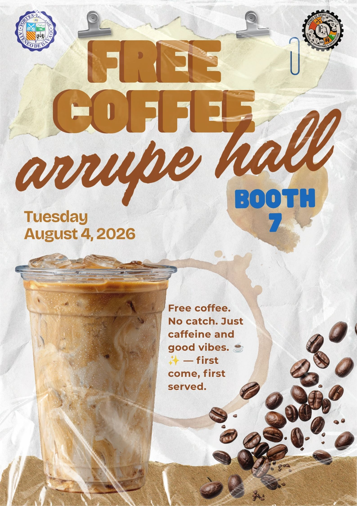

# 🎀 ACTIVITY 1

## GE 4120 – [Activity Title]

### 📌 Activity Description
This activity focuses on creating a visually appealing and informative presentation using fundamental design principles. It involves applying contrast, alignment, balance, and visual hierarchy to communicate information effectively. The design highlights important details, particularly the free coffee announcement and event information, while maintaining an organized and aesthetically pleasing layout.

### 💻 Files Included

### 🌸 What Have I Learned?
Through this activity, I learned:

Contrast – How to emphasize important information by using differences in colors, sizes, and styles.
Alignment and Balance – How to organize text and visual elements to create a clean and well-structured design.
Visual Hierarchy – How to guide the viewer's attention toward the most important information, making the presentation easier to understand.

### 🧩 Challenges & Solutions
One challenge I encountered was arranging the text and visual elements without making the presentation look crowded. I solved it by carefully adjusting the spacing, alignment, and placement of each element. I also used contrasting colors and different font sizes to make the important details more noticeable.

### 🚀 Future Applications
I can apply the knowledge and skills I gained from this activity to future programming exercises, presentation designs, and engineering-related tasks. Understanding these design principles will also help me create more organized, user-friendly, and visually effective outputs.

<text color="secondary" size="xs" weight="medium">MADE WITH 🌷 | GE 4120 – FINALS PROJECT</text>

[⬅ Back to Main Portfolio](/README.md)
