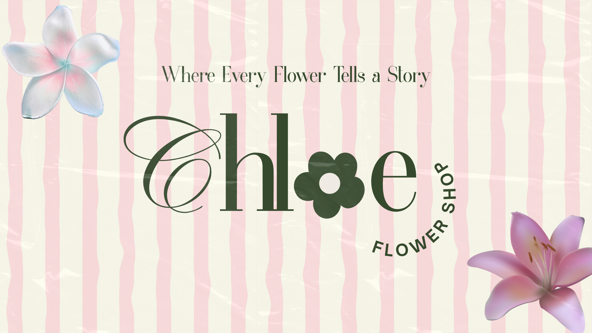
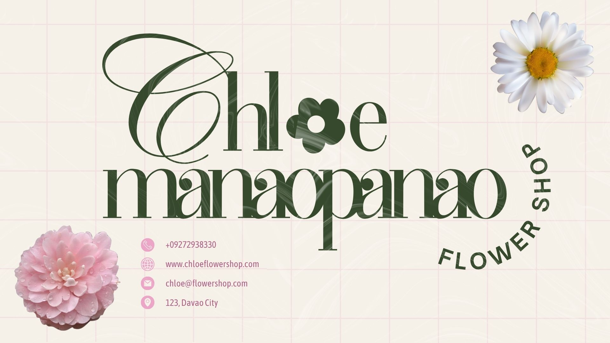
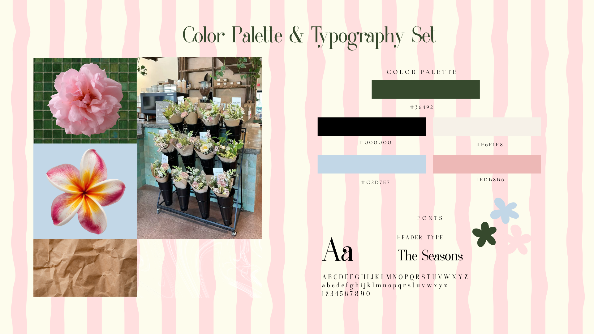

# ✦ ACTIVITY 02 ✦
### COLOR PALETTE AND TYPOGRAPHY

**GE 4120 | PRELIM EXAM**

*Flower Shop Branding and Visual Identity*

---

## 01 — TAGLINE

I chose soft pink, light blue, cream, and dark green as the main colors because they reflect the natural beauty and freshness of a flower shop. The soft pink represents love, sweetness, and the delicate appearance of flowers, while the light blue gives the design a calm, fresh, and peaceful feeling.

I used cream as the main background color because it creates a warm and clean appearance without being too harsh. The dark green represents leaves, plants, nature, and growth, making it an important color for connecting the design to flowers and the natural environment. I also used black for some elements to create contrast and make the important details easier to notice.

---

## 02 — HEADER

For the typography, I chose an elegant serif font because I wanted the flower shop to have a sophisticated, delicate, and timeless identity. The style of the font complements the floral images and gives the overall design a more premium and artistic feel.

I used larger and more decorative typography for the main headings so they would immediately attract attention, while the smaller text is kept simple and readable.

---

## 03 — COLOR PALETTE & TYPOGRAPHY

Overall, the combination of colors and typography creates a soft, elegant, feminine, and nature-inspired look that represents the beauty and personality of my flower shop brand.

---

## 04 — DESIGN REFLECTION

Through this activity, I learned how important color selection and typography are in establishing a brand's visual identity. I understood how different colors communicate emotions and how font styles influence the overall appearance and personality of a design.

I also learned that consistency between colors, typography, and visual elements helps create a more organized and recognizable brand.

---

---

**CHLOE AIAH A. MANAOPANAO**

*GE 4120 | Ateneo de Davao University*

✦ Designing with creativity and purpose. ✦

[← Back to Main Portfolio](/README.md)

