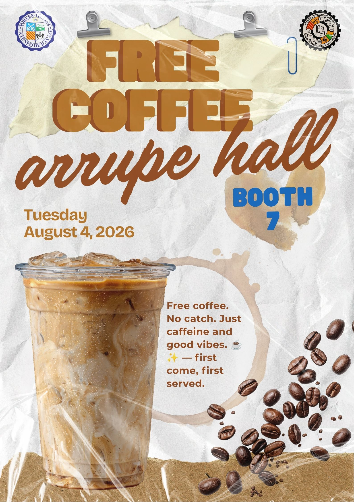
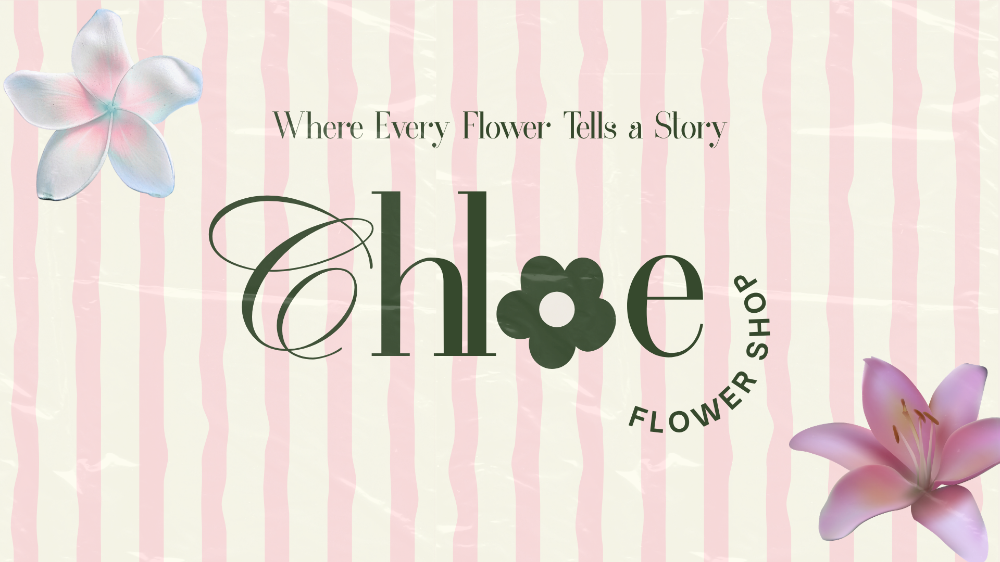
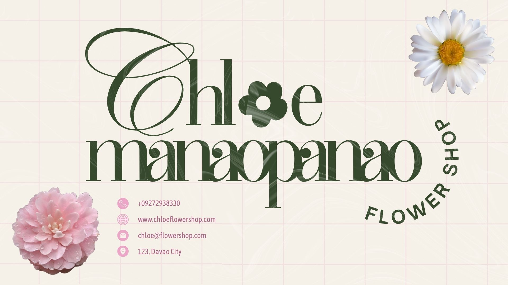
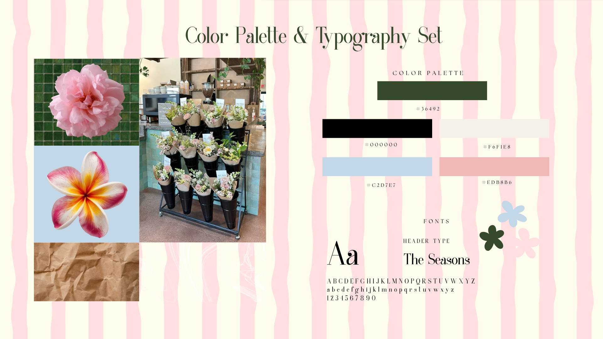

# PRELIM-EXAM_MANAOPANAO
My GitHub portfolio organizes my activities, projects, and outputs in one accessible space.

<!DOCTYPE html>
<html lang="en">
<head>
    <meta charset="UTF-8">
    <meta name="viewport" content="width=device-width, initial-scale=1.0">
    <title>My Digital Portfolio</title>

    
</head>

<body>

<header>
    <h1>MY DIGITAL PORTFOLIO</h1>
    
My Academic Journey & Creative Works

</header>

<nav>
    <a href="#home">Home</a>
    <a href="#about">About Me</a>
    <a href="#academic">Academic Works</a>
    <a href="#projects">Projects</a>
</nav>

<section id="home">
    <h2>Welcome to My Portfolio!</h2>
    
A collection of my academic works, projects, and achievements.

</section>

<section id="about">
    <h2>About Me</h2>
    
Hello! I am a Civil Engineering student.
    This portfolio showcases my academic journey,
    projects, and learning experiences.

</section>

<section id="academic">
    <h2>Academic Works</h2>

    

        

            <h3>PRELIMS</h3>
            
First grading period outputs.

            <a href="prelims.html">View Works</a>
        

        

            <h3>MIDTERMS</h3>
            
Midterm academic outputs.

            <a href="midterms.html">View Works</a>
        

        

            <h3>FINALS</h3>
            
Final grading period outputs.

            <a href="finals.html">View Works</a>
        

    

</section>

<section id="projects">
    <h2>Engineering Projects</h2>
    

        

            <h3>My Projects</h3>
            
Explore my engineering projects and outputs.

            <a href="projects.html">View Projects</a>
        

    

</section>

<footer>
    
© 2026 My Digital Portfolio

</footer>

</body>
</html>

## Activity 1: Presentation Design Principles 

I applied design principles such as contrast, alignment, balance, and visual hierarchy to make the presentation clear and easy to understand. I used contrast to make important information stand out, while alignment kept the text and elements organized. I also maintained balance by arranging the content properly so the design did not look crowded. The use of visual hierarchy helped guide the viewer’s attention from the main title to the important details, such as the free coffee announcement and event information. These principles made the presentation more organized, readable, and visually appealing.

## Activity 2: Color Palette and Typography
### TAGLINE

I chose soft pink, light blue, cream, and dark green as the main colors because they reflect the natural beauty and freshness of a flower shop. The soft pink represents love, sweetness, and the delicate appearance of flowers, while the light blue gives the design a calm, fresh, and peaceful feeling. I used cream as the main background color because it creates a warm and clean appearance without being too harsh. The dark green represents leaves, plants, nature, and growth, making it an important color for connecting the design to flowers and the natural environment. I also used black for some elements to create contrast and make the important details easier to notice.

### HEADER

For the typography, I chose an elegant serif font because I wanted the flower shop to have a sophisticated, delicate, and timeless identity. The style of the font complements the floral images and gives the overall design a more premium and artistic feel. I used the larger and more decorative typography for the main headings so they would immediately attract attention, while the smaller text is kept simple and readable. Overall, the combination of the colors and typography creates a soft, elegant, feminine, and nature-inspired look that represents the beauty and personality of my flower shop brand.

### COLOR TYPOGRAPHY 
 

## Activity 3: Social Media Infographics and Mini Project Documentation
.png)

My output is an infographic called “SmartStudy: A Digital Solution for Managing College Workload & Study Time.” The main concept is to present a common problem among college students—being overloaded with assignments, exams, projects, and group activities and introduce SmartStudy as a digital solution. The infographic shows how too much workload can lead to poor time management, procrastination, stress, fatigue, and lower performance. It then presents the solution and explains how SmartStudy can help students organize tasks, monitor deadlines, prioritize workloads, focus during study sessions, and track their progress.

For the design choices, I used a warm and playful color palette with cream, yellow, coral, green, and black. The cream grid background gives the infographic a notebook or study-planner feeling, which connects well with the topic of college students and studying. Yellow is used to highlight important sections such as “The Problem” and “The Solution,” while coral is used for other major headings and boxes to create contrast and guide the reader through the infographic. I also used bold, playful typography for the headings to make them noticeable and energetic, while the simpler text style keeps the information readable. The illustrations of pencils, notebooks, calculators, rulers, flowers, and graduation-related elements reinforce the student and academic theme.

For the creative process, I first identified the problem of college students struggling to manage multiple responsibilities. I then organized the information into clear sections: the problem, real-world impact, solution, and how SmartStudy works. I arranged these sections in a logical top-to-bottom flow so that the viewer can easily follow the problem and understand how the proposed solution addresses it. I added simple icons, illustrations, arrows, check marks, and highlighted text to make the information easier to scan instead of relying only on long paragraphs. Overall, I aimed to create an infographic that is informative, visually engaging, organized, and easy for college students to understand.
